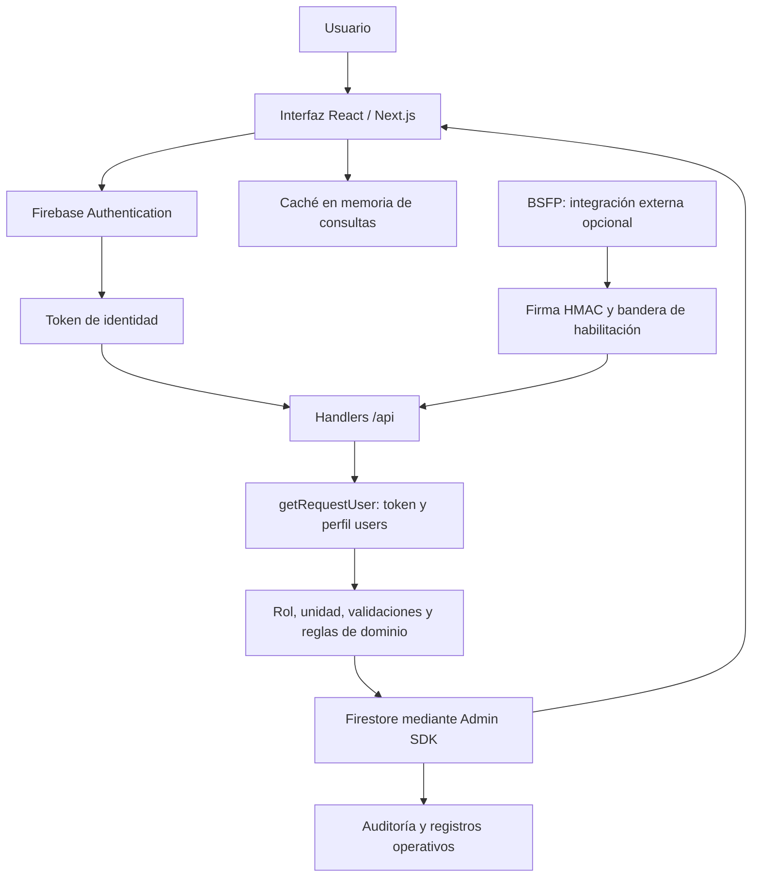

# Base de conocimiento y preparación del cambio funcional

**Fase actual acordada:** probar manualmente en local antes de publicar; comprobar el despliegue antes de depurar los registros identificados como pruebas. Ver [acceso y recorrido de prueba local](PRUEBA_LOCAL_MANUAL.md). El entorno manual usa únicamente datos ficticios en emuladores; no se ha ejecutado publicación ni limpieza real.

**Estado más reciente, 27/10/2026:** el usuario autorizó aplicar el plan. Consultar [implementación de reincidencia y validación](IMPLEMENTACION_REINCIDENCIA_2026-10-27.md): código local comprobado, sin publicar ni migrar datos reales. Al cancelar la base, se cuenta un nuevo año desde la sanción promovida. Se verificaron48 pruebas de dominio/importación y30 de servidor, más12 comprobaciones en navegador. El diagnóstico real de solo lectura detectó5 registros que requieren revisión:2 por solapamiento y3 por bifurcación. Este estado prevalece sobre las notas inferiores que limitaban la autorización a planificar.

**Continuidad 27/10/2026:** existe una nueva implementación local, todavía sin publicar. Leer primero [estado funcional y validación](IMPLEMENTACION_FUNCIONAL_2026-10-27.md). Las tablas y hallazgos inferiores describen la versión de referencia auditada; no sustituyen las decisiones posteriores ni el estado del diff. El padrón nuevo es general, se retiran asignaciones de policías por unidad y se incorporan confirmaciones, plazos y rebaja de cadenas por cancelación extraordinaria.

**Última revisión de reincidencia, 27/10/2026:** leer [diagnóstico y plan por conducta original](reincidencia-2026-10-27/DIAGNOSTICO_Y_PLAN.md). Hay fallos confirmados en la separación de cadenas del mismo policía; las pruebas previas no certificaban ese escenario. La última solicitud autoriza actualizar el plan, no implementar ni publicar las correcciones. La conducta original conserva su artículo/inciso aunque la sanción aplicada sea10/1 o11/1. El plazo aprobado es un año desde la sanción original de la cadena9/X o10/X, sin renovación por reincidencias; al vencer se admite nueva base y nueva cadena, conservando toda la historia. Esto sustituye la propuesta de ventana móvil y reclasificaR03 como resultado correcto; R13 documenta la falta de control integral del vencimiento.

Actualizada: 26/10/2026. Versión de código de referencia: `b141f5b7321e3f19bf4643595b5deeced511466e`.

## Mandato del usuario y estado

**Antecedente operativo confirmado por el usuario el 26/10/2026:** la app ya estaba desplegada, conectada funcionalmente a Firebase y siendo utilizada en la práctica. El trabajo corresponde a la evolución de un sistema operativo existente. Preservar continuidad de servicio, datos y funcionamiento de los usuarios durante los cambios. Esta declaración documenta experiencia operativa del usuario; no constituye una nueva prueba técnica ejecutada por el auditor.

El usuario solicita conservar el conocimiento de la app y de su auditoría para modificaciones importantes de funcionalidad por usuario. Antes de implementar, se debe entender objetivo, funcionamiento actual, interacciones y problemas, y definir con él el enfoque deseado. **Todavía no se ha definido ni aprobado una nueva matriz de permisos.** No interpretar esta preparación como autorización para inventar roles, modificar reglas disciplinarias, migrar datos o desplegar cambios.

Este documento describe el código local inspeccionado. La auditoría y sus evidencias permanecen en `docs/auditoria-2026-10-26/INFORME.md`. No se corrigieron los hallazgos ni se volvió a verificar el sistema completo con cuentas reales. La revisión no incluyó reglas remotas, pruebas autenticadas, revisión visual, restauración de backups y validación normativa; esas limitaciones de la auditoría no significan que el despliegue o la conexión Firebase estén pendientes de implementación o hayan fallado.

## Objetivo actual

El nombre de la app, README, interfaz y flujos implementados describen un sistema institucional multiunidad de registro y control de faltas disciplinarias del Comando Departamental de Policía de Chuquisaca. Centraliza personal, unidades, sanciones, antecedentes, solicitudes para dejar sin efecto, transferencias y administración de usuarios. Apoya la detección de reincidencia y la consulta/reportes departamentales.

La síntesis anterior está fundamentada en la implementación. No sustituye un documento formal de requisitos institucionales. Tampoco acredita que cada regla disciplinaria programada corresponda a la normativa vigente.

## Arquitectura e interacción

- Frontend: `src/components/disciplinario-app.tsx`, componentes por módulo y hooks de auth/API/caché/unidades. La navegación principal usa estado de React; la página de entrada es `/`.
- Backend: `src/app/api/**/route.ts`. `getRequestUser` verifica token y consulta el documento `users`. Firebase Admin realiza las escrituras y no depende de las reglas del cliente para autorizar cada operación.
- Reglas del cliente: `firestore.rules`. Son una segunda superficie de acceso, principalmente de lectura. Deben revisarse junto con los endpoints.
- Dominio: `src/lib/domain/*`, `src/lib/faltas/reincidencia.ts`, `src/lib/imports/historical-sanctions.ts`.
- No hay una matriz única aplicada exhaustivamente: existen helpers, conjuntos de roles, condiciones en endpoints y filtros en menús. Cambiar solo la interfaz o un helper puede dejar rutas inconsistentes.

## Roles actuales: permisos declarados y restricciones

Esta matriz refleja los controles explícitos del código, **no garantiza que los fallos de autorización identificados estén cerrados**.

| Acción | operador_unidad | admin_unidad | visor_dpto | admin_dpto | super_admin |
|---|---|---|---|---|---|
| Personal, dashboard y reportes | Propia unidad | Propia unidad | Lectura global | Lectura global | Lectura global |
| Historial por unidad | Propia | Propia | Selecciona unidad | Selecciona unidad | Selecciona unidad |
| Historial explícito `global_person` | No | No | Sí | No | Sí |
| Registrar falta actual | No | Sí, propia unidad | No | Sí | Sí |
| Registrar falta histórica manual | No | No | No | Sí | Sí |
| Importar sanciones históricas en bloque | No | No | No | No | Sí |
| Crear personal individual | No | No | No | Sí | Sí |
| Importar/reiniciar padrón en bloque | No | No | No | No | Sí |
| Gestionar solicitudes de traspaso | No | Sí | No | Sí | Sí |
| Transferencia directa | No | Hacia su unidad | No | Global, con requisito actual de unidad propia | Global, con requisito actual de unidad propia |
| Ver auditoría general de traspasos | No | No | No | Sí | Sí |
| Solicitar dejar sin efecto | Sí | Sí | No | API permite | API permite |
| Resolver solicitudes / anular directamente | No | No | No | Sí | Sí |
| Ver/editar usuarios y relevar roles de unidad | No | No | No | Sí, con restricciones | Sí |
| Crear/dar de baja usuarios | No | No | No | No | Sí |
| Gestionar unidades | No | No | No | Sí | Sí |

Precisiones necesarias para el rediseño:

- `canViewGlobalPersonHistory` incluye `visor_dpto` y `super_admin`, pero excluye `admin_dpto`. No asumir que los roles forman una jerarquía estrictamente acumulativa.
- La consulta de faltas sin `scope=global_person` permite vías más amplias de las indicadas en esa fila: H01. No presentar el permiso declarado como aislamiento efectivo.
- La API de solicitudes de anulación permite roles globales; la UI inicia solicitudes principalmente desde historial para roles de unidad. Ver y poder ejecutar son dimensiones distintas.
- El menú de escritorio muestra “Importar Personal” a `admin_dpto`, que puede crear personal individual dentro de esa pantalla; la carga masiva sigue reservada a `super_admin`. El menú móvil no incluye esa entrada.
- Restricciones del último superadministrador y de jerarquía no se aplican uniformemente entre PATCH, DELETE y relevo: H02/H09.

Fuentes principales: `src/lib/domain/roles.ts`, `constants.ts`, `src/app/api`, `sidebar.tsx`, `mobile-nav.tsx` y componentes de historial/personal/importación.

## Datos y relaciones que deben preservarse

| Colección | Función y relaciones |
|---|---|
| `users` | Perfil de acceso asociado al UID de Firebase Auth; rol, unidad, identificación, estado y cambio obligatorio de contraseña |
| `unidades` | Catálogo de unidades, nombre y estado; IDs referenciados por usuarios, personal y eventos |
| `personal` | Efectivo, CI, grado, nombres, sexo, estado y unidad actual |
| `ci_registry` | Reserva/asociación de CI normalizado con `personalId` para unicidad |
| `faltas` | Sanción con `personalId`, copia identificativa, artículo/inciso, fecha, documento, motivo, unidad sancionadora y del efectivo; estado y referencias de reincidencia |
| `reincidencias_bloqueadas` | Intentos de registro bloqueados y contexto; no equivale a personas únicas ni a sanciones impuestas |
| `solicitudes_eliminacion_falta` | Petición sobre una falta, motivo/tipo, solicitante y resolución; la operación final es anulación lógica |
| `transferencias_solicitudes` | Movimiento propuesto, origen/destino, vencimiento, respuesta y actores |
| `transferencias_logs` | Movimientos realizados y su trazabilidad |
| `imports_personal` | Resumen de carga, filas y errores |
| `imports_sanciones` y subcolección `rows` | Vista previa, datos normalizados, errores, confirmación y reversión |
| `integraciones_sanciones` | Identificador externo, estado, payload/hash y sanción asociada para integración BSFP |
| `audit_logs` | Actor, acción, entidad, antes/después y fecha; atomicidad desigual según la operación |

**Distinciones importantes:** unidad actual del efectivo, unidad que sancionó y unidad donde prestaba servicio al momento del hecho no son intercambiables. La continuidad del historial depende de conservar `personalId`, además del CI. Cambiar de unidad no debe confundirse con crear una persona nueva. Usuarios de acceso y efectivos del padrón son entidades distintas.

## Flujos principales

1. **Acceso:** Firebase autentica → frontend obtiene token → `/api/me` devuelve perfil → UI abre módulos según rol o pantalla de cambio obligatorio. Las demás llamadas llevan Bearer token. El bloqueo del primer cambio y la revocación tienen pendientes H03/H12/H17.
2. **Personal:** alta individual valida datos y reserva CI en transacción; carga masiva crea o actualiza por CI. Búsqueda local/global depende de rol y filtros, con límites silenciosos actuales. La importación puede cambiar unidad del efectivo al actualizar sus datos; debe considerarse al definir quién controla movimientos.
3. **Registro:** selecciona unidad/efectivo → artículo/inciso/fecha/documento/motivo → backend valida rol/ámbito y antecedentes → registra falta con auditoría o responde bloqueo y sugerencia. Modo histórico permite indicar unidad de servicio pasada; no equivale a modificar la unidad actual.
4. **Reincidencia:** ventana programada de 365 días hacia atrás desde la fecha ingresada; consulta global por persona. Los incisos de escalada requieren origen. El código admite como bases de Art. 11 inc. 1 antecedentes de Art. 9 o 10; no reducirlo sin decisión fundamentada. Art. 12 inc. 1 genera remisión y no se registra como falta en las rutas manual/integración. Verificar estas reglas con fuente normativa antes de cambiarlas.
5. **Historial:** filtro por unidad o persona global autorizada; muestra sanciones y solicitudes. La consulta devuelve copias históricas y estados. Anular conserva el documento; la revisión de dependencias está pendiente.
6. **Dejar sin efecto:** solicitud por representación/error de inserción → revisión global → aprobación/rechazo → posible anulación con actor/motivo. Hay además DELETE directo global con motivo. Definir si ambas vías deben seguir existiendo.
7. **Traspasos:** envío desde unidad de origen → solicitud pendiente de 24 horas → aceptación/rechazo por destino o autoridad global → cambio de unidad y logs. Coexiste traslado directo sin solicitud. El vencimiento tiene caminos distintos, incluidos efectos de escritura en GET.
8. **Usuarios:** alta en Auth y perfil Firestore → contraseña temporal → edición/baja/relevo. Relevo bloquea saliente y asigna entrante; debe proteger jerarquía, continuidad administrativa y sesiones.
9. **Importación histórica:** archivo CSV/XLSX → normalización y consistencia → filas válidas/advertidas/rechazadas → confirmación textual → escrituras por lotes → consulta de errores o reversión. Tiene máximos declarados de 5 MB y 2.000 filas. La habilitación por variable es permisiva salvo valor `false`; no confundirlo con la integración BSFP, que exige `true`.
10. **Reportes:** agregaciones sobre sanciones registradas y eventos bloqueados; filtros de unidad/fecha; dashboard resume totales y recientes. Frontend usa caché en memoria. Requiere mejorar definiciones, temporalidad y escalabilidad.
11. **Integración:** BSFP envía sanciones firmadas por HMAC con timestamp; backend registra estado e identificador externo. Deshabilitada en el entorno local probado. No se verificó una conexión activa. No atribuir a este repositorio endpoints o funciones de la otra aplicación.

## Registro de problemas: todos pendientes

Los IDs son estables y remiten al informe de auditoría para ubicación, evidencia, severidad y aceptación. No marcar un hallazgo resuelto por cambiar un menú, por una compilación exitosa o por una prueba simulada que no abarque el comportamiento.

| ID | Problema | Relación con cambios de rol/función |
|---|---|---|
| H01 | Historial ajeno consultable por personalId | Ámbito de lectura y datos mínimos para reincidencia |
| H02 | Relevo modifica cuentas superiores | Jerarquía y delegación administrativa |
| H03 | Confirmación de contraseña sin cambio real | Sesión y operaciones permitidas en primer acceso |
| H04 | Rol de unidad sin unidad y consultas abiertas | Invariantes del perfil y denegación por defecto |
| H05 | Tipificación fuera del catálogo | Autoridad para registrar y validación central de dominio |
| H06 | Vencimiento aborta su actualización | Estados y respuesta verdadera del flujo de traspaso |
| H07 | Traslado directo elude solicitudes | Política pendiente: aprobación o facultad directa |
| H08 | Solicitud de anulación sobre sanción ajena | Autoridad sobre recurso y divulgación de datos |
| H09 | PATCH elude protección del último superadmin | Continuidad y protección de administración |
| H10 | Dependencias con avisos críticos/altos | Actualización técnica transversal; alcance por entorno |
| H11 | HTML no escapado al imprimir errores | Protección de la sesión del usuario que imprime |
| H12 | Reglas sin estado activo y revocación incompleta | Igualdad de controles API/Firestore/sesión |
| H13 | Importaciones parciales y recuperación débil | Quién confirma/reintenta/revierte y con qué garantías |
| H14 | Reinicio del padrón rompe relaciones históricas | Eliminar/reimportar no debe destruir identidad |
| H15 | Listados/búsquedas/antecedentes truncados | Visibilidad efectiva y decisiones con datos completos |
| H16 | Unicidad/auditoría no uniformes | Concurrencia y consistencia entre vías de operación |
| H17 | Token inválido tratado como fallo interno | Expiración, errores y experiencia de acceso |
| H18 | Anulación no revisa sanciones dependientes | Procedimiento de revisión y sustento normativo |
| H19 | CSV de personal sin interpretación de comillas | Contrato de importación y validación |
| H20 | Integración diverge en validación/estados | Autoridad del servicio externo e idempotencia |

Observaciones adicionales que también deben conservarse: accesibilidad/foco de modales, fecha UTC frente a Bolivia, caché y cambio de identidad/rol, costo de consultas completas, significado de métricas, cabeceras locales, cobertura de pruebas/CI, health sin verificación de dependencias, documentación desactualizada, IAM/secretos/historial Git sin auditoría exhaustiva y backups sin restauración probada. Detalle en el informe.

Evidencia del 26/10: build/lint/tipos correctos, cinco tests existentes aprobados, nueve reproducciones aisladas, 33 operaciones sin token con 401, health 200 e integración 503. npm reportó 29 paquetes afectados (incluido desarrollo), no 29 exploits demostrados. Estos resultados son históricos y deben revalidarse proporcionalmente a los cambios.

## Definición del enfoque deseado: pendiente del usuario

Antes de implementar cambios importantes, completar una matriz **rol × acción × recurso × ámbito × condición × datos visibles**. Ejemplos de condición: cuenta activa, unidad asignada, traslado pendiente/aceptado, autoría, fecha, aprobación y estado de la sanción. Evitar resolver todo con nombres de roles o visibilidad de botones.

| Decisión | Estado | Qué debe quedar definido |
|---|---|---|
| Roles y responsabilidades futuras | Pendiente | Mantener, redefinir o crear roles; quién ejerce cada función |
| Registro de faltas | Pendiente | Quién registra, en nombre de qué unidad y para qué efectivos |
| Historial global y reincidencia | Pendiente | Quién ve expediente completo; quién solo obtiene verificación mínima |
| Traspasos | Pendiente | Quién inicia, acepta, rechaza y puede reasignar directamente |
| Anulación y representación | Pendiente | Solicitante, resolutor, excepciones y antecedentes dependientes |
| Administración de cuentas | Pendiente | Alta, edición, bloqueo, relevo y protección de autoridad superior |
| Importación y mantenimiento | Pendiente | Cargas permitidas, confirmación, reversión y prohibiciones de borrado |
| Reportes | Pendiente | Indicadores, alcance, exportaciones y datos identificativos visibles |
| Migración de usuarios/datos existentes | Pendiente | Mapeo de roles, unidades, sesiones, compatibilidad e historial |
| Integración BSFP | Pendiente | Continuidad deshabilitada o habilitación tras corregir/validar contrato |
| Normativa | Pendiente | Fuente vigente y reglas disciplinarias que deben permanecer/cambiar |

Enfoque técnico propuesto, todavía sujeto al alcance que se acuerde: definir primero responsabilidades y permisos; centralizar autorización y reglas de dominio; aplicar cambios coordinados en API, reglas Firestore, UI y caché; conservar identidad e historial; migrar con respaldo verificable; probar la matriz y flujos afectados; preparar una publicación revisable. Los fallos H07 y el procedimiento de H18 requieren definición operativa, no una decisión unilateral del desarrollador.

## Protocolo de continuidad

Skills locales revisadas y configuración exclusiva de Codex: ver [evaluación y recomendaciones](SKILLS_CODEX.md). Las instrucciones canónicas residen en `.agents/skills/` del repositorio; el workspace padre las enlaza sin duplicarlas. La memoria histórica `.ai/decisions.md` documenta aceptación obligatoria para traspasos: H07 es una divergencia respecto de esa política, aunque las excepciones de la futura versión siguen pendientes de decisión.

1. Leer este documento y el informe antes de nuevas modificaciones; verificar commit y cambios locales.
2. Contrastar el módulo afectado con su API, reglas, colecciones, consumidores y pruebas. No asumir que el snapshot sigue vigente.
3. Registrar las instrucciones nuevas del usuario y su precedencia frente a decisiones anteriores. Separar estado actual, objetivo acordado y propuesta todavía pendiente.
4. Para cada cambio: anotar permiso anterior/nuevo, pantallas, endpoints, reglas, datos/migración, riesgos y pruebas de aceptación.
5. Cerrar cada Hxx únicamente con evidencia proporcional; conservar el informe original como referencia histórica y registrar la resolución en un documento posterior.
6. Mantener este proyecto separado de otros. Una relación de integración no autoriza a reutilizar sus datos ni a cambiar la otra aplicación.

Los documentos están guardados localmente; no equivalen a un commit, respaldo remoto o despliegue. La actualización de memoria autorizada por el usuario guarda una referencia a esta base, no credenciales ni datos personales.
